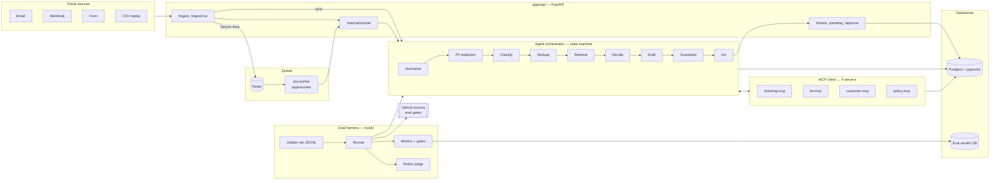

# Support Triage Agent

A support-triage agent that ingests tickets (email / webhook / form / CSV), classifies
them, detects duplicates and incidents, retrieves knowledge-base articles and customer
context through MCP tools, decides whether to auto-resolve, draft, or escalate, and then
acts (tags, routes, drafts, internal notes) — all wrapped in a first-class **eval
harness** with CI gates.

> The organizing idea: **build the eval harness as early as the agent itself.** Every
> pipeline stage emits a typed, independently-evaluable result, so a change to a prompt,
> model, or threshold is measurable on a versioned golden set before it ships.

---

## Architecture



**Request path.** A ticket hits `POST /ingest`. Synchronously (default) the API persists
it and runs the agent inline; with `?async=true` it is persisted with status `processing`
and handed to Redis, where an arq worker claims it and calls back into
`POST /internal/worker`. The worker path is **fail-open**: if Redis is unreachable the API
still runs the agent inline, so a ticket is *never silently dropped*.

**Agent path.** The orchestrator is an explicit state machine — not one giant prompt.
Each stage writes a typed result (`agent/schemas.py`) to a `RunRecorder`, so every stage
is inspectable and independently scoreable.

---

## The eval harness (the core)

Metrics are computed per layer, on a **versioned** dataset, driven by a **config file**,
and enforced by **CI gates** that block a merge on regression.

| Layer | Metrics |
|-------|---------|
| Classification | accuracy, per-class P/R/F1, confusion matrix, per-slice accuracy |
| Decision | **escalation recall** (headline), auto-resolve precision, decision accuracy |
| Retrieval | recall@k, MRR, hit rate |
| Reply quality | rubric judge (weighted dimensions), judge pass rate |
| Safety | injection / PII / groundedness / policy guardrail pass rates, adversarial suites |
| Ops | cost, latency, token usage, error rate |

- **Datasets** — versioned JSONL (`evals/datasets/golden_v0.jsonl`) with a `slice` field and
  a held-out split to avoid eval leakage. See [`evals/datasets/README.md`](evals/datasets/README.md).
- **Suites** — `smoke` (fast must-pass), `regression` (full set), `adversarial`
  (injection/PII/out-of-policy/no-KB). Defined as data in [`evals/suites.py`](evals/suites.py).
- **Judge** — rubric-based LLM-as-judge with Cohen's-kappa calibration against human
  labels and pairwise position-swapping for A/B comparisons
  ([`evals/judges/`](evals/judges)).
- **Reproducibility** — [`evals/config.py`](evals/config.py) loads a YAML config that pins
  dataset version, model routing, judge mode, and gate thresholds. A run records a config
  snapshot so results trace back to exact settings.

### CI gates

Every push and PR runs the three suites on a **hermetic offline config**
([`configs/ci.yaml`](configs/ci.yaml): deterministic stub LLM + heuristic judge, no API key,
no network). `evals.cli run` exits non-zero when a gate fails, so a regression blocks the
merge. See [`.github/workflows/evals.yml`](.github/workflows/evals.yml).

```bash
make eval-ci     # reproduce the CI gates locally
```

---

## Quickstart

```bash
# 1. install
pip install -e ".[dev]"
cp .env.example .env          # set ANTHROPIC_API_KEY for real models

# 2. start Postgres (pgvector) + Redis
make up

# 3. create tables + seed KB articles / sample tickets
make migrate && make seed

# 4. run the API and a worker (separate terminals)
make api
make worker
```

Ingest a ticket:

```bash
curl -X POST "http://localhost:8000/ingest?async=true" \
  -H "Content-Type: application/json" \
  -d '{"subject":"Refund please","body":"I was charged twice for invoice 123."}'
```

Run evals:

```bash
python -m evals.cli run --suite smoke --config configs/ci.yaml
python -m evals.cli run --suite regression --config configs/v1.yaml --persist
python -m evals.cli list-runs
python -m evals.cli diff last prev
```

---

## Deployment (AWS)

The production topology is a **single EC2 host running Docker Compose**, backed by managed
**RDS Postgres (pgvector)** and **ElastiCache Redis** — the cheapest way to run the real
architecture (queue + worker + pgvector). The API container publishes no host port; `nginx`
is the only public surface and it blocks the unauthenticated `/internal/worker` and
`/tickets/{id}/approve` routes.

```bash
AWS_REGION=us-east-1 ANTHROPIC_API_KEY=sk-ant-... ./infra/aws/provision.sh up
./infra/aws/deploy.sh            # redeploy after a code change
./infra/aws/provision.sh down    # tear everything down
```

**Already have EC2 + RDS + ElastiCache?** Skip provisioning and build the image on your
existing host:

```bash
cp infra/host/env.example .env && nano .env   # fill in the RDS/ElastiCache/Anthropic values
./infra/host/deploy-on-host.sh                # build, start, migrate, seed
```

Full guides: [`docs/deployment-aws.md`](docs/deployment-aws.md) (provision from scratch) ·
[`docs/deploy-existing-host.md`](docs/deploy-existing-host.md) (use existing infra) · why
this topology: [ADR 0009](docs/adr/0009-single-ec2-compose-deployment.md).

---

## Repository layout

```
agent/                 state-machine pipeline: schemas, PII, LLM client, prompts,
                       embeddings, hybrid retrieval, tools, orchestrator
apps/api/              FastAPI ingest + review API, SQLAlchemy models, seed, DB
apps/worker/           arq worker (idempotent jobs, retry/backoff, DLQ)
mcp_servers/           4 MCP servers: ticketing, kb, customer, policy
evals/                 dataset, suites, config, runner, metrics, judges, CLI, storage
configs/               eval run configs (ci.yaml = hermetic, v1.yaml = real models)
infra/aws/             AWS provisioning + EC2 bootstrap + redeploy scripts
infra/host/            deploy onto an existing EC2 host (env template + one-shot script)
infra/nginx/           reverse proxy config (blocks internal/approve routes in prod)
docs/                  architecture, ADRs, eval report, AWS deployment guides
tests/                 pytest suites
Dockerfile             hardened multi-stage image (serves both the API and the worker)
docker-compose.yml     local dev stack (postgres, redis, api, worker)
docker-compose.prod.yml  production stack (managed RDS/ElastiCache, nginx in front)
docker-compose.host.yml  production stack built on an existing host (no ECR)
```

## Make targets

| target | purpose |
|--------|---------|
| `make up` / `down` / `logs` | docker compose stack (postgres, redis, api, worker) |
| `make migrate` / `seed` | create tables / load seed data |
| `make api` / `worker` | run API / arq worker locally |
| `make test` / `lint` / `fmt` | pytest / ruff check / ruff format |
| `make eval-smoke` / `eval-regression` / `eval-adversarial` | single-suite eval (`configs/v1.yaml`) |
| `make eval-ci` | offline CI gates (all suites, `configs/ci.yaml`) |

## Design rules

- **Low confidence → escalate.** Missing an escalation is the costly error, so escalation
  recall is the headline decision metric and the gates weight it highest.
- **Any LLM or tool failure → escalate.** Fail closed, never silently drop.
- **Refunds, account changes, legal → human approval.** Risky actions are recorded as
  pending actions, never executed by the agent.
- **Read tools are separated from write tools** across MCP servers; writes hit per-server
  tokens and approval gates.
- **Prompt-injection defense** runs as an explicit guardrail stage.

## Documentation

- [`docs/architecture.md`](docs/architecture.md) — components, data flow, sequencing.
- [`docs/evals.md`](docs/evals.md) — metric definitions, suites, configs, how to add items.
- [`docs/eval-report.md`](docs/eval-report.md) — baseline results and gate outcomes (reproducible).
- [`docs/deployment-aws.md`](docs/deployment-aws.md) — cheapest-viable AWS deploy (EC2 + RDS + ElastiCache).
- [`docs/deploy-existing-host.md`](docs/deploy-existing-host.md) — deploy onto an existing EC2 host (copy-paste checklist).
- [`docs/adr/`](docs/adr/) — architecture decision records.

## Status

Phases 1–7 of the build plan are implemented: repo/schema/ingest, agent pipeline, the
full eval harness with CI gates, the 4 MCP servers, and the queue/worker path. A minimal
AWS deployment (single EC2 host + managed RDS/ElastiCache) is now provided under
[`infra/aws/`](infra/aws/) — see [`docs/deployment-aws.md`](docs/deployment-aws.md) and
[ADR 0009](docs/adr/0009-single-ec2-compose-deployment.md). The Next.js review dashboard and
tracing UI (phase 6) plus shadow mode (the remaining part of phase 8) are still pending.
